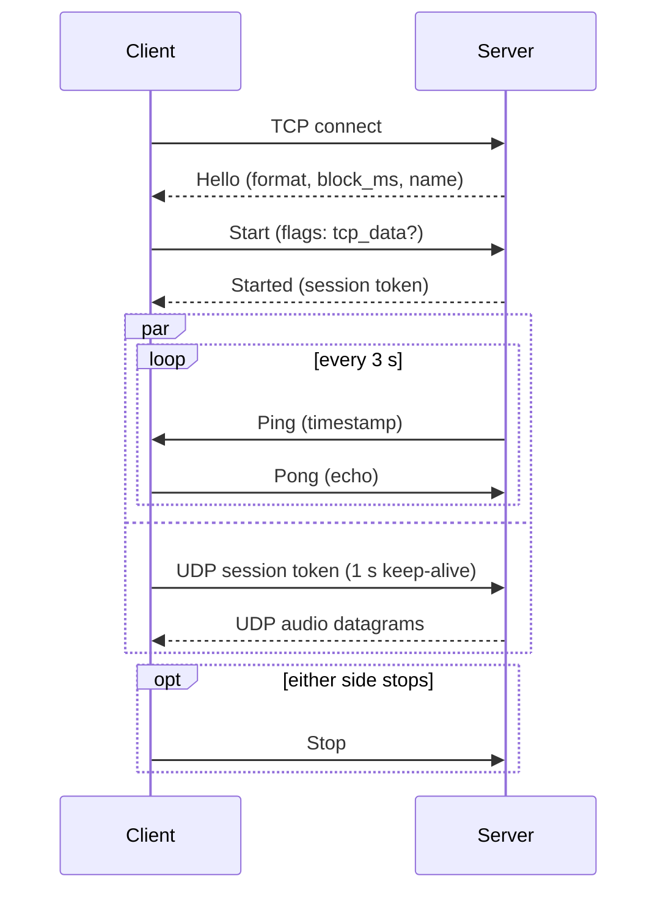

# ASR2 — Audio Share Rust wire protocol (v2)

Two channels between host and players, mirroring the original project's
proven split but with self-describing, endian-safe framing. All integers
are **little endian**.

- **TCP** (control; optionally audio): frame stream
- **UDP** (audio): datagrams

## TCP frame

```
offset  size  field
0       4     magic = "ASR2"
4       2     version (u16) = 2
6       1     frame type
7       1     flags
8       4     payload length (u32)
12      n     payload
```

Header is 12 bytes; max payload 4 MiB.

### Frame types

| type | name | direction | payload |
|---|---|---|---|
| 1 | `Hello` | server → client | audio format + block ms + name (below) |
| 2 | `Start` | client → server | empty; flags bit 0 = request audio over TCP |
| 3 | `Started` | server → client | `session` u32 |
| 4 | `Audio` | server → client (TCP mode) | `seq` u32 + PCM bytes |
| 5 | `Ping` | server → client | server-clock timestamp u64 |
| 6 | `Pong` | client → server | echoed timestamp u64 |
| 7 | `Stats` | client → server, echoed back | client-clock timestamp u64 (echo = RTT probe; also counts as keep-alive) |
| 8 | `Stop` | either | empty (graceful end) |

### `Hello` payload

```
0   2  encoding: 0 = s16le, 1 = f32le
2   2  channels (u16)
4   4  sample rate (u32)
8   2  block_ms (u16)
10  2  name length (u16)
12  n  server name (UTF-8, ≤ 64 bytes)
```

## UDP

Client → server (registration + keep-alive, every 1 s):

```
session u32
```

Server → client (audio):

```
session u32 | seq u32 | PCM...
```

Datagrams are sized to fit one MTU (payload ≤ 1464 bytes) and snapped to
sample-frame boundaries. `seq` counts segments and is used for loss
accounting. The client must send its token from the socket it will receive
on; the server refreshes the endpoint on every datagram.

## Handshake sequence



## Semantics

- The server pings every 3 s and drops a peer after 12 s of silence.
- PCM is always interleaved, little endian, in the negotiated encoding.
- TCP-data mode is byte-equivalent to UDP mode (same seq numbering);
  clients buffer identically, so mode is a pure transport choice.
- The server fills silence while the capture source is quiet, keeping
  client jitter buffers stable across pauses.
